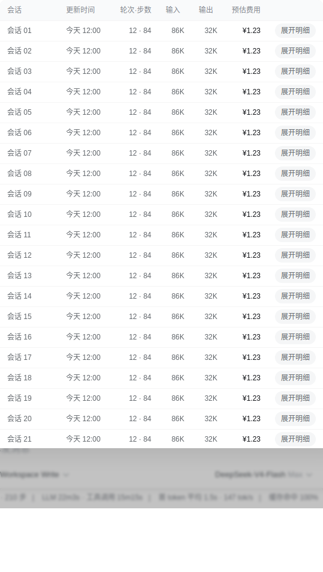
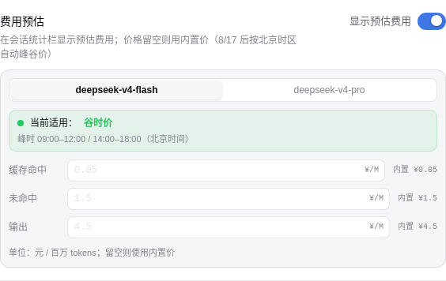
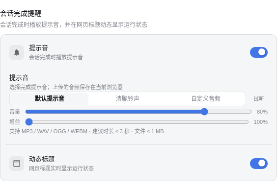
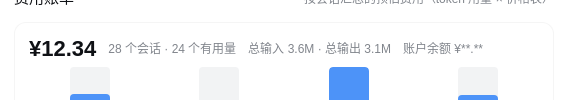

# 插件类 — 本助手创建的动态插件

存放 DSH 会话中由本助手通过 `cordis_define` 创建的**动态 Cordis 插件**源码。

> 原则：只提交**自己写**的插件；第三方/别人的插件不入库。

## 目录约定

每个插件一个子目录，以 `pluginId` 命名：

```
插件类/<pluginId>/
├── README.md        # 插件用途、版本历史、运行说明
├── host.js          # Host 端源码（如有）
└── client.js        # Client 端源码（如有）
```

## 归档流程

1. `cordis_define` 创建/更新插件 → `cordis_run` 运行验证
2. `cordis_inspect_self(pluginId, packageId)` 取出最新 Package 源码
3. 保存到本目录对应 `pluginId` 子目录，提交前运行 `scripts/check-secrets.sh --all` 审查
4. 推送

## 当前状态

| pluginId | 名称 | 版本 | 说明 |
|---|---|---|---|
| `cfgf-1` | 配置文件网页编辑器 | pkg-3（运行中） | 设置页新增「配置文件」页面，网页内查看/编辑 settings.yaml，密钥脱敏 |
| `baln-4` | 余额查询 | pkg-5（运行中） | Host `balance` RPC + 会话头部余额徽标（5s 轮询） |
| `sntf-5` | 会话完成提醒 | pkg-12 v2（**已弃用**） | agent/status 监听 + 提示音/标题闪烁/提醒卡片；**已由 `dsh-session-notify/` 静态包取代** |
| `tokm-1` | Token 用量统计 | pkg-14 v2（运行中） | `tokenUsageByModel` 投影注册 + composer.dock 用量行（样式令牌化） |
| `imgr-3` | 粘贴图片转文字 | pkg-4（运行中） | `agent/pre-step` 拦截替换 image 块 → GLM 识别，内容寻址缓存 |
| `cost-6` | 费用预估与账单明细 | pkg-16 v6（**已弃用**） | Host 折叠引擎 + 费用行/总账单/货币卡/价格卡；**已由 `dsh-cost-ledger/` 静态包取代** |
| `sshp-1` | 会话分享 | pkg-3（运行中，已静态化） | 分享ID 登记 + 发布对话框（shell.overlay）+ 管理页 + `read_shared_session` 工具；**静态版见 `dsh-session-share/`** |
| `dsh-mods-enhanced` | 增强功能静态化常驻包 | 1.0.0 | **非动态插件**：5 个动态插件合并为 profile 静态插件，随 dsh web 启动自动加载 |
| `dsh-session-share` | 会话分享静态化常驻包 | 1.0.0 | **非动态插件**：sshp-1 的常驻版（自有 `/sshp/*` 路由 + 工具），配套 `patches/dsh-client-ui-workspace-share.patch` 菜单入口 |
| `dsh-model-select-provider-label` | 模型选择器增强 | 1.0.0 | **非动态插件**：触发按钮显示 提供商·模型·推理等级，级联面板 |
| `dsh-session-notify` | 会话完成提醒 | 1.0.0 | **非动态插件**：sntf-5 的常驻版（运行标题指示 + 提示音/标题 ✓/提醒卡 + 音色音量设置卡），不依赖补丁 |
| `dsh-cost-ledger` | 费用账本 | 0.1.0+ | **非动态插件**：cost-6 的常驻版（`lib/` 折叠引擎 + 价格/汇率账本 + 闲时与费用悬浮面板 + 搜索/抓取按次计费 + 检索内容 token 拆分） |
| `dsh-deepseek-status` | DeepSeek 服务状态胶囊 | 0.2.0 | **非动态插件**：输入框工具条状态胶囊 + 悬浮面板（status.deepseek.com，宿主同源代理、30 天逐日格子、组件可用率与事件）；新插件 |

> 注：`dsh-mods-enhanced` / `dsh-session-share` / `dsh-model-select-provider-label` /
> `dsh-session-notify` / `dsh-cost-ledger` / `dsh-deepseek-status` 是静态化常驻包
> （`~/.dsh/profiles/web/plugins/` 或 bundle），不是动态插件；随服务启动自动生效。
>
> **弃用约定**：被静态包取代的动态插件只保留源码归档，并在其 README 顶部标注「已弃用」+
> 指向替代目录（当前：`sshp-1` → `dsh-session-share/`、`sntf-5` → `dsh-session-notify/`、
> `cost-6` → `dsh-cost-ledger/`）。

## 当前客户端(profile `web`)已安装插件清单

以 `~/.dsh/profiles/web/package.json` 与 `cordis.patch.yml` 为准(2026-11-03 核对):

| 安装形态 | 名称 | 版本 | 仓库源码 | 说明 |
|---|---|---|---|---|
| profile 插件(bundle) | `dsh-deepseek-status` | 0.2.0 | `插件类/dsh-deepseek-status/` | 服务状态胶囊 + 悬浮面板(status.deepseek.com) |
| profile 插件 | `dsh-cost-ledger` | 0.1.0 | `插件类/dsh-cost-ledger/` | 费用账本(替代 cost-6):折叠引擎 + 悬浮面板 + 搜索/抓取按次计费 + 检索内容 token 拆分 |
| profile 插件 | `dsh-session-notify` | 1.0.0 | `插件类/dsh-session-notify/` | 会话完成提醒(替代 sntf-5),不依赖补丁 |
| profile 插件 | `dsh-session-share` | 1.0.0 | `插件类/dsh-session-share/` | 会话分享(替代 sshp-1),配套 `patches/dsh-client-ui-workspace-share.patch` 与 `patches/ui-conversation-sharechip.patch` |
| profile 插件 | `dsh-model-select-provider-label` | 1.0.0 | `插件类/dsh-model-select-provider-label/` | 模型选择器显示 提供商·模型·推理等级(级联面板) |
| 第三方依赖(file:) | `@deepseek-ai/dsh-tool-see-image` | 0.2.0 | **不入库** | npm 包「看图工具」(作者 gugu123a):给纯文本模型加 `see_image` 能力;按本目录「只提交自己写的插件」原则不归档第三方源码,升级走 npm/file 依赖 |

> 其余 `@deepseek-ai/*` 是 dsh 自带 bundle,不属于本仓库。
> `增强主页类/dsh-mods/` 与 `patches/` 是**补丁形态**的界面增强,单独维护,不在此清单内。

## 效果预览

各插件的界面效果见 `docs/screenshots/`（均为演示数据，金额/会话标题已替换或打码）：

| 插件 | 截图 |
|---|---|
| cost-6 费用行 / tokm-1 用量行 |  |
| cost-6 总账单页 |  |
| cost-6 价格卡 |  |
| cost-6 货币卡 |  |
| sntf-5 设置卡 |  |
| imgr-3 图片转文字 |  |
| baln-4 余额徽标 |  |
